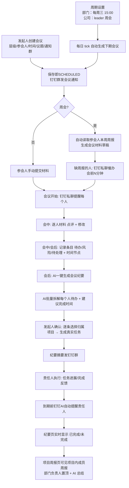

# 会议管理（Meeting）PRD v1.0

| 项 | 内容 |
| --- | --- |
| 文档状态 | **方案已确认，待开发**（v1.2 已吸纳你对 6 个决策点的批复） |
| 目标模块 | 新增 `apps/api/src/modules/meeting` + `apps/web/src/views/MeetingListView.vue` / `MeetingDetailView.vue`；改造 `ProjectDetailView.vue`（项目周报）、`DepartmentView.vue`（部门周会周期位） |
| 关联模块 | 项目 / 任务 / 周报日报 / 钉钉群通知 / 钉钉私聊提醒 / AI 提示词 / 通知中心 / 会议室资源 |
| 作者 | MyOrgniz 研发（AI 辅助撰写） |
| 修订记录 | v1.0 首版，覆盖事前-事中-事后全流程<br/>**v1.1** 新增：①会议分层（部门周会 / 公司 leader 周会 / 项目会议 / 临时会议）；②部门自定义周会时间 + 每周自动生成；③**项目周报聚合视图**（成员周报 + 部门负责人置顶 + AI 总结）；④项目/部门页一键发起会议<br/>**v1.2** 吸纳用户批复（见 §16.1）：①**一个部门可配多场周会**（新表 `DepartmentMeetingSlot`）；②**冷启动策略**：首场进草稿 + 私聊负责人发布，负责人发布过一次后转为自动发群（`autoPilot`）；③会议规则负责人随时可改；④同项目/同会议内周报互见；⑤leader 周会取部门汇总周报 |

---

## 1. 背景与目标

### 1.1 现状问题

团队目前的信息流动是**分散**的：

- 周报写在各人自己的 Report 里，看团队全貌要一个人一个人点开；
- 会议口头产生的待办，靠会后手工录到任务看板，容易漏、容易没有时间节点；
- 钉钉群里有通知，但通知和系统内的任务没有关联，「说了什么」和「谁去做」断裂；
- 老板（管理者）review 时提的调整意见、风险点，没有沉淀载体，事后无法追溯。

### 1.2 目标

把**线下开会的自然流程**完整搬到线上，形成一个闭环：

> 事前准备材料 → 材料聚合在一起 → 会上逐人讨论（点评/修改）→ 现场派活（待办 + 时间节点）→ 会后 AI 沉淀纪要并落到每个人的任务 → 执行与反馈 → 到期钉钉提醒 → 纪要里可见已完成/未完成。

一句话概括产品定义：**根源是会议纪要，执行是每一个任务。**

### 1.2.1 v1.1 补充目标：分层会议 + 项目周报

两个追加诉求，本质是把上面的闭环**按企业真实组织层次铺开**：

1. **分层开会**：部门开部门的周会（时间每个部门自己定，系统每周自动生成），公司 leader 层开公司的周会（参会人 = 全体部门负责人），临时拉一个项目会/组长碰头会（随时手动创建）。每一层都有自己的会议纪要与待办闭环，不互相干扰。
2. **项目也是看周报的地方**：不只会议里才能看到周报聚合——在项目页就能看「这个项目每个成员本周干了什么」，**部门负责人排第一**，顶部一份 AI 总结。项目周报与会议材料复用同一套聚合直排组件与取数逻辑，口径完全一致。

### 1.3 非目标（本期不做）

- 音视频会议、屏幕共享（走钉钉原生能力，本系统不做集成）
- 钉钉日历双向同步（只做到「钉钉消息通知」，不做到「日历邀请」）
- ~~周期性/重复会议~~ → **v1.1 纳入范围**：仅支持「每周固定星期几 + 固定时间」这一种最简单周期（部门周会、公司 leader 周会），由系统按部门设置每周自动创建会议；**不做**复杂重复规则（每两周 / 每月第 N 个周三 / 跳过节假日 / 钉钉日历式重复邀请）
- 会议纪要的 Word/PDF 导出与版本历史（仅保留最新修订 + 点评记录）
- 外部（非本系统账号）参会人
- 会议室审批流（仅复用已有资源预订，不新增审批）

---

## 2. 术语与核心概念

| 术语 | 定义 |
| --- | --- |
| 会议（Meeting） | 一次有明确参会人、时间段、议题的协作事件；是本模块的核心聚合根 |
| 会议层级（scope） | 会议对应的组织层次：`DEPT` 部门周会 / `COMPANY` 公司（leader 层）周会 / `PROJECT` 项目会议 / `PERSONAL` 小组或临时会议。**不同层级的参会人来源和会前材料不同**，模拟企业里「部门开部门的会、公司开公司 leader 的会」 |
| 会议模板（Template） | 按层级预置的发起参数集合：参会人自动解析规则、会前材料要求、通知群、周期时间。发起人一键套用后可再调整 |
| 周期设置（Recurrence） | 部门级/公司级的「每周几 + 几点 + 是否自动创建」配置，存于 `Department` 表与 `Setting` 表；由 queue 每周落地为一条会议记录 |
| 会议材料（Material） | 会前由参会人提交、或系统自动读取的正文（如周报）。**周会的材料 = 参会人的周报** |
| 点评（Review） | 会议主持/管理员针对某份材料写的意见，不覆盖原文，独立留痕 |
| 会议条目（MeetingItem） | 会议中记录的三类条目：`TODO`（待办）/ `RISK`（风险）/ `PENDING`（会后待处理），**必须带完成时间节点** |
| 会议纪要（Minutes） | 会后 AI 生成 + 人工确认的整体纪要（结论 + 条目总览），存于 Meeting 上 |
| 落地任务（Task） | 会议条目确认后写入项目任务体系的真实任务，条目通过 `taskId` 回链 |

**关键设计原则：会议条目 ≠ 任务。** 条目是「会议视角的记录」，任务是「执行视角的工作项」。条目确认（confirm）后才生成任务；任务状态回写条目，实现「纪要里看到已完成/未完成」。

---

## 3. 角色与权限

沿用现有角色序 `ADMIN(3) > DEPT_LEADER(2) > PROJECT_LEADER(1) > MEMBER(0)`（`common/permissions.ts`）。

| 能力 | 参会人 | 会议发起人（主持人） | 管理员 |
| --- | --- | --- | --- |
| 发起会议、邀请他人 | ✅ | ✅ | ✅ |
| 提交自己的会前材料 | ✅ | ✅ | ✅ |
| 查看会议聚合材料 | ✅（本会议内） | ✅ | ✅ |
| 点评他人材料 | ❌ | ✅ | ✅ |
| **修改他人材料** | ❌ | ✅（写入 `editedContent`，原文 `rawContent` 永久保留） | ✅ |
| 记录会议条目 | ❌ | ✅ | ✅ |
| AI 生成纪要 / 批量生成待办 | ❌ | ✅ | ✅ |
| 确认条目 → 生成任务 | ❌ | ✅（本会议条目） | ✅ |
| 编辑会议整体纪要 | ❌ | ✅ | ✅ |
| 执行/反馈条目 | — | — | 条目责任人本人 + 管理员 |

> **权限决策（已确认 Q1/Q12）**：被邀进会议 / 同项目成员 = 互相可见彼此**已提交**的周报内容。系统**不主动越权拉取**未被邀请者、未提交者的周报。

---

## 4. 整体流程设计

### 4.1 主流程（周会场景，端到端）



### 4.2 会议状态机

`Meeting.status`：

| 状态 | 含义 | 进入条件 | 页面表现 |
| --- | --- | --- | --- |
| `DRAFT` | 草稿 | 创建未发布 | 仅发起人可见，不发任何通知 |
| `SCHEDULED` | 已安排 | 发起人「发布会议」 | 立即发钉钉群通知；材料区显示提交进度 |
| `IN_PROGRESS` | 进行中 | 到达开始时间（queue 自动）或发起人手动「开始会议」 | 材料区进入「点评/修改」编辑态；条目录入可用 |
| `MINUTING` | 纪要整理中 | 主持人点「结束会议」 | 条目可继续补录；AI 生成纪要可用 |
| `DONE` | 已完成 | 主持人点「确认纪要」 | 只读为主，条目仍可通过任务联动更新完成状态 |
| `CANCELLED` | 已取消 | 主持人取消 | 钉钉群发取消通知；已生成任务不动 |

> 允许「跳过进行中直接整理」：`SCHEDULED → MINUTING`（很多周会是线上快速同步，不需要系统内打卡开会）。

---

## 5. 功能清单（含优先级）

| 编号 | 功能 | 阶段 | 优先级 | 说明 |
| --- | --- | --- | --- | --- |
| F1 | 创建/编辑/取消会议（参会人、议题、时间、地点、通知群） | 事前 | P0 | 支持选择已有钉钉群，或输入群会话 ID |
| F2 | 会议发布 → 钉钉群自动通知 | 事前 | P0 | 复用 dws `chat +send-to-group` |
| F3 | 参会人提交会前材料 | 事前 | P0 | 文本粘贴；周报类型可「一键从我的周报带入」 |
| F4 | 周会：自动读取参会人周报聚合 | 事前 | P0 | 见 §6.2 |
| F5 | 材料提交进度看板 + 缺交催办（钉钉私聊） | 事前 | P0 | 会前可配置提前分钟数 |
| F6 | 会议开始提醒（钉钉私聊每人） | 事中 | P0 | 复用 `DingtalkDmService.notifyUser` |
| F7 | 聚合材料文档视图（姓名 + 部门 + 正文直排） | 事中 | P0 | **非目录逐条点开**，单页直排、可滚动 |
| F8 | 会中点评材料 | 事中 | P0 | 独立留痕，不覆盖原文 |
| F9 | 会中修改材料正文 | 事中 | P0 | 写 `editedContent`，`rawContent` 保留 |
| F10 | 会中记录条目（待办/风险/会后待处理 + 时间节点） | 事中 | P0 | 支持「快速记一条」，也支持会后补录 |
| F11 | 会议材料/条目语音或文本速记 → AI 结构化 | 事中 | P1 | 降低会上记录成本；见 §9 |
| F12 | AI 一键生成会议纪要 | 事后 | P0 | 聚合材料 + 条目 → 纪要 |
| F13 | AI 批量生成每个人待办 + 完成时间节点 | 事后 | P0 | 复用 PBC 拆解任务的成熟范式 |
| F14 | 条目确认 → 生成真实任务（选归属项目） | 事后 | P0 | 见 §7.3 硬约束 |
| F15 | 纪要摘要发钉钉群 | 事后 | P0 | 「整体纪要 + 待办总览」发群，明细落个人任务 |
| F16 | 已完成/未完成事项视图 | 事后 | P0 | 由回链任务状态派生，实时 |
| F17 | 条目到期前钉钉 AI 自动提醒责任人 | 事后 | P0 | 扩展现有逾期提醒机制 |
| F18 | 通知中心站内信（会议邀请/开始/条目指派/纪要发布） | 全程 | P0 | `Notification` |
| F19 | 管理员「拉取部门周报 → AI 润色 → 生成我的周报」 | 事前 | P1 | 独立快捷入口，见 §8.4 |
| F20 | 会议室资源预订联动 | 事前 | P2 | 已有 `Resource(type='meeting_room')` |
| F21 | 会议列表筛选/搜索（我的/我发起的/全部，按类型与状态） | 全程 | P0 | — |
| F22 | 会议详情「关联项目进展」展示 | 事后 | P2 | 条目转任务后，任务关联的 `ProjectUpdate` 可在侧栏看 |
| **F23** | **会议层级与模板**（部门周会/公司 leader 周会/项目会议/临时会议） | 事前 | **P0** | 见 §6.11，选层级后参会人自动解析 |
| **F24** | **部门自定义周会时间**（一个部门可配多场：名称/每周几/几点/时长/通知群） | 事前 | **P0** | 周期位表 `DepartmentMeetingSlot`，见 §6.11.3 |
| **F25** | **每周自动创建周期会议**（部门周会 + 公司 leader 周会） | 事前 | **P0** | queue 按周期位生成；**首场进草稿由负责人发布，之后自动发群**（§6.11.5） |
| **F26** | **公司 leader 层周会**（参会人 = 全体部门负责人 + 管理员） | 事前 | **P0** | 全局设置项，管理员维护 |
| **F27** | **项目周报聚合视图**（项目内每个成员的周报情况） | 全程 | **P0** | 见 §6.12，**部门负责人/项目负责人排第一** + 顶部 AI 总结 |
| **F28** | 项目详情页「发起项目会议」快捷入口（预填参会人 + 关联项目 + 通知群） | 事前 | **P0** | 临时项目会议 |
| **F29** | 部门页「发起部门会议」快捷入口（预填部门成员；含组长临时碰头） | 事前 | **P0** | 临时部门/组长会议 |
| **F30** | 项目周报 AI 总结提示词 `project.weekly.summary` + 手动刷新 | 全程 | P1 | 结果可缓存，重复点开不重复计费 |

---

## 6. 详细功能设计

### 6.1 事前：发起会议

**入口**：侧栏「会议管理」→「发起会议」；首页「全部功能」快捷组内同名入口（移动端侧栏已满，走首页快捷组）。

**表单字段**

| 字段 | 必填 | 说明 |
| --- | --- | --- |
| 会议主题 | ✅ | ≤80 字；按层级预填默认名（如「技术部 第42周 周会」） |
| **会议层级** | ✅ | `DEPT` 部门周会 / `COMPANY` 公司 leader 周会 / `PROJECT` 项目会议 / `PERSONAL` 临时-小组会议。**决定参会人自动解析规则与会前材料要求**，见 §6.11 |
| 会议类型 | ✅ | `WEEKLY` 周会 / `DAILY` 日会-站会 / `PROJECT` 项目会 / `REVIEW` 评审会 / `OTHER` 其他（层级与类型正交：层级=谁的会，类型=什么的会） |
| 开始 / 结束时间 | ✅ | 北京时间口径（沿用 `fmtBeijing` 存储约定）；结束须晚于开始 |
| 参会人员 | ✅ | 多选用户；默认带发起人本人（主持人）；支持「按部门批量选」 |
| 会议内容/议题 | ✅ | 多行文本，AI 生成纪要时作为主线 |
| 会前材料要求 | — | 开关 + 说明。周会类型默认开启且默认要求「本周周报」 |
| 关联项目 | — | 可选，多选；用于条目落地任务的默认项目 |
| 钉钉通知群 | — | 下拉列出现有项目的 `dingtalkGroupName/dingtalkConversationId`；也可手填群会话 ID |
| 会议地点 | — | 文本；F20 可实现为会议室资源选择并自动建预订 |
| 开始提醒 | — | 开关，默认开；提前 N 分钟（默认 0 = 准点） |
| 材料提交截止 | — | 默认 = 会议开始时间 |

**校验**：参会人 ≥1；时间合法；周会必须选择「读取周报的周期」（默认本周，可上一周）。

**层级预选**：从项目详情页点「发起项目会议」进入时，层级=`PROJECT`、关联项目=当前项目、参会人=项目成员、通知群=该项目绑定群，全部自动填好（F28）；部门页同理（F29）。

**发布动作**：`POST /api/meetings` → 状态 `SCHEDULED` → 同步发钉钉群通知 + 站内信 + 材料提交催办排程（不阻塞响应，通知失败仅记日志、页面提示「通知发送失败，可手动重发」）。

### 6.2 事前：会前材料聚合（周会读周报）

**两种来源，同一份 `MeetingMaterial`**

| 来源 | 触发 | 内容 |
| --- | --- | --- |
| `REPORT` | 周会/日会类型，主持人点「读取周报/日报」或创建时勾选自动读取 | 从 `Report(type=WEEKLY/DAILY, ownerId=参会人, periodStart=所选周期周一)` 取正文 |
| `MANUAL` | 参会人在会议详情页自己提交 | 自由文本 |
| `DOC` | 从知识库带入（P2） | `KnowledgeDoc` 引用 |

**读取逻辑（严格贴合现有周报数据结构）**

现有周报正文 `Report.content` 是 JSON：`{ summary, sections: [{ title, items: [] }], nextWeek }`；手写周报另有 `rawContent` / `correctedContent`。聚合时按优先级取值：

1. `correctedContent`（AI 修正后的文本，最干净）
2. `rawContent`（手写原文）
3. 由 `content` JSON 结构化拼接：`摘要` → 各 `sections`（标题 + 条目列表）→ `下周计划`

读取写入 `MeetingMaterial.rawContent`（快照），**不实时跟随后续周报修改**（会议是对某一时点材料的讨论，需要快照一致性）；主持人可在材料页点「重新读取最新周报」显式刷新，刷新保留旧快照到 `revisions` 记录。

**缺交处理**：参会人在所选周期无周报 → 材料项标 `MISSING`，聚合页显示「张三 · 技术部：未提交本周周报」，并进入催办名单。

**催办（复用现有提醒范式）**：到 `remindBeforeAt = startAt - remindBeforeMinutes`，由 queue 给 `MISSING` 参会人发钉钉私聊：「明天 15:00 的《XX周会》需要你的本周周报，请在会前完成提交或提交材料」。频控：**每北京日每人每会议最多 1 条**（`Meeting.lastRemindAt` + 参会人级 `lastRemindAt`）。

### 6.3 事中：会议开始提醒

queue 到点触发（默认准点，可提前 N 分钟），对每个参会人发钉钉私聊：

```
📅 会议提醒
《产品迭代周会》即将开始（10:20 - 11:00）
地点：3号会议室
议题：本周迭代进展、遗留待办确认
材料：8人已就绪 / 1人未提交
进入系统查看会议材料 → hzai.work/meetings/{id}
—— 来自 MyOrgniz 团队协作系统
```

同时写站内信；主持人端可收到「全员已提醒」回执（失败列表）。

**禁发窗口（已定稿 Q3）**：现有提醒体系有**禁发时段 20:00–07:00**。会议**开始提醒与会议群通知豁免该窗口**（强时效事件，凌晨 2 点的会也必须准点提醒，否则这条功能形同虚设）；**材料催办、草稿待发布提醒、待办到期/逾期提醒仍遵守禁发窗口**，窗口内的提醒排队到次日 07:00 后发。实现方式：`sendIfAllowed(meeting, kind)` 里对 `kind ∈ {START_REMIND, GROUP_NOTIFY, MINUTES}` 跳过窗口判断，其余 kind 复用 `SEND_HOUR_FROM=7 / SEND_HOUR_TO=20`。

### 6.4 事中：聚合材料文档视图（核心体验）

**设计要点（直接回应你的诉求）**：不是「一个一个目录去点击查看」，而是一份**连续的、类文档的单页直排**：

```
┌── 2026年第42周 团队周会 · 会议材料（共 9 人）────────┐
│                                                      │
│  张三 · 技术部                          [编辑] [点评] │
│  ─────────────────────────────────────────────────  │
│  本周进展                                            │
│   1. 完成会议管理模块方案设计…                       │
│   2. 首页备案号上线…                                 │
│  下周计划                                            │
│   1. 会议管理开发…                                   │
│  ⚑ 主持人点评（10:15）：第2项要补充验收标准          │
│  ✎ 已被主持人修改（原文可查看）                      │
│                                                      │
│  李四 · 产品部                          [编辑] [点评] │
│  ─────────────────────────────────────────────────  │
│  …                                                   │
│                                                      │
│  杨丽 · 运营部                                       │
│  ⚠ 未提交本周周报                                    │
└──────────────────────────────────────────────────────┘
```

- 顶部：会议信息条（主题/时间/地点/参会人头像/材料就绪度）+ 操作（开始会议、AI 生成纪要、发送到群）
- Tab：**材料**（默认）｜**纪要与待办**｜**反馈**
- 每人一段：姓名（加粗）+ 部门 + 分隔线 + 正文；正文支持行内编辑（主持人）
- 点评以「气泡脚注」内嵌在该人段落下方，带记录人与时间
- 支持整页复制 / 打印（浏览器打印即可，不专门做导出）
- 移动端：同样直排，折叠「已点评完的人」保证滚动效率（P1）

### 6.5 事中/会后：会议条目（待办 / 风险 / 会后待处理）

**录入表单**

| 字段 | 必填 | 说明 |
| --- | --- | --- |
| 类型 | ✅ | `TODO` / `RISK` / `PENDING` |
| 内容 | ✅ | 一句话描述，≤300 字 |
| 责任人 | ✅（`TODO`/`PENDING`）| 从参会人里选（可含发起人自己）；`RISK` 可选填「关注人」 |
| 完成时间节点 | ✅（`TODO`/`PENDING`）| 日期（可含时间）；`RISK` 为「复核时间」 |
| 来源材料 | — | 关联某人的某份材料（点击可回溯到那段讨论） |
| 优先级 | — | 复用任务 `LOW/MEDIUM/HIGH/URGENT`，默认 MEDIUM |

**列表视图**：按人分组（「张三（3 条 / 逾期 1）」），顶部统计：待办 N、风险 M、待处理 K、已确认 X、已完成 Y。

**补录**：`MINUTING`/`DONE` 状态下主持人仍可新增条目（「这些信息也可以在会后去录入」）。

### 6.6 事后：AI 一键生成纪要 + 批量生成待办

两个独立按钮，顺序使用：

**① AI 生成会议纪要**（prompt `meeting.minutes`）
输入：会议主题/类型/议题 + 各参会人材料摘要 + 全部条目 + 全部点评。
输出 JSON：`{ overview, conclusions:[], progress:[], risks:[], todos:[], pending:[] }`
写入 `Meeting.minutes`（可人工编辑后保存）。

**② AI 批量生成每个人的待办 + 完成时间节点**（prompt `meeting.tasks`）
输入：会议议题 + 条目 + 点评 + 各人材料。
输出：`{ items: [{ ownerName, content, dueDate, reason }] }`
落地：**完全照搬 PBC「AI 拆解 → 人工预览 → 确认创建任务」的既有交互范式**（`pbc.service.decompose` / `createTasksFromPbc`）：
- AI 结果先展示为**预览清单**（不直接写库）
- 每条可编辑标题/责任人/时间/归属项目
- 点「确认创建」才逐条落库生成 `Task` + 回写 `MeetingItem`

**AI 降级策略**（沿用 `AiService` 现有约定）：调用失败返回 `null`，业务层降级——纪要区提示「AI 生成失败，可手工填写纪要」；待办拆解降级为「把已录入条目原样转为任务，时间按会议日期 +7 天平铺」（复用 `spreadDue` 思路），流程不阻断。

### 6.7 事后：条目 → 任务（关键约束）

**硬约束（现有代码决定，不可绕过）**：`Task.projectId` **非空**；`tasks.service.create()` 要求**被指派人必须是该项目成员**（PBC 拆解里已见过报错文案「该成员不是项目「x」的成员，无法把任务指派到该项目」）。

因此会议待办落地任务必须有归属项目。方案：

1. 会议创建时选「关联项目」（多选）→ 作为条目落地任务的默认项目；
2. AI 预览清单里，每条给出该项目下候选项目下拉（复用 PBC 返回的 `projects / defaultProjectId`）；
3. 若责任人不在所选项目成员内 → 该行标红提示，让用户改选项目或改选责任人（**不做「自动把人拉进项目」**，避免污染项目成员，见 §16 Q4）。

**无显式归属项目时的默认项目（已定稿 Q5：不建「日常事务」兜底项目，按部门各自挂到其主项目）**，解析优先级：

1. `Meeting.projectId`（会议本身关联项目，项目会议天然走这条）；
2. 条目**责任人所属部门**的「部门默认会议项目」`Department.meetingProjectId`（新增可空字段，部门负责人在部门页选定，一场部门的会派生的待办默认落这个项目）；
3. 未配置 `meetingProjectId` 时，若该部门通过 `ProjectDepartment` **恰好只关联一个项目**，用它；关联 0 个或多个则**不猜**；
4. 以上都没命中 → AI 预览清单该行标黄「需选择项目」，`confirm` 时强制选择后才落库（沿用 `needProject` 交互）。

> 明确**不引入**跨部门共用的「日常事务」项目，避免杂事灌进项目看板；部门主项目由各部门自己指定，归属清晰，运营**无需预先建任何共享兜底项目**（原「团队事务」方案作废）。

条目与任务关系：`MeetingItem.taskId` 回链（`onDelete: SetNull`，任务被删条目仍留痕）。任务状态变化 → 会议「反馈」页与纪要条目实时反映已完成/未完成（口径同 `myTasks`：`status=DONE` 为已完成，其余未完成，`dueDate < now` 且未完成为逾期）。

**责任人的个人待办在哪看**：不需要新增「会议待办」列表——因为落地就是真实 `Task`，自然出现在：首页「我的待办」、任务页「我负责的」、`myTasks.todo`。这正是你要的「明细待办落到每个人的待办事项中」。若条目尚未 confirm（会议还没结束/主持人没确认），则在会议详情页「我的会议待办」区可见草稿态条目。

### 6.8 事后：纪要摘要发钉钉群

主持人点「发布纪要」→ 群发（同 `daily-digest` 排版风格，emoji + markdown）：

```
📝 会议纪要 · 产品迭代周会（10-20）

【结论】完成会议管理方案评审；下周进入开发
【本周进展】
· 张三（技术部）：完成备案悬挂上线…
· 李四（产品部）：需求评审 3 场…
【待办 9 条】张三 3 · 李四 2 · 王五 4（最晚 10-27）
【风险 2 条】DeepSeek 额度受限（复核 10-24）
明细已同步到各人任务列表 → hzai.work/meetings/{id}
✨ 下次周会：10-27 15:00
```

同时给每个责任人发私聊（可开关，默认开）：「你在《XX周会》有 3 条待办，最晚 10-27，点击查看」。私聊走 `notifyUser` + `ccReminders` 抄送管理员（复用现有范式）。

**落地口径（P0-b 已上线）**：会议详情抽屉里主持人可直接编辑纪要，两个按钮——「保存纪要」（只存不发）与「保存并发到群」（写库后投递 `MINUTES` 队列任务，约 1 分钟内以 `dws chat +send-to-group` 发出）。幂等口径：`minutesSentAt` 已置且那之后没再改过纪要 → 不重推；**改过纪要（`minutesEditedAt` 晚于 `minutesSentAt`）自动视为新版本，允许再发**；内容未改而要重发则用「纪要发到群」按钮（`force`）。当前群正文 = 纪要原文（超 1200 字截断）+ 会议时间/地点 + 详情链接；**上面模板里的【结论】/【待办 N 条】/【风险 N 条】/【下次周会】结构化排版属 P0-d**（AI 汇总后写进同一个 `minutes` 字段，通道不变）；逐责任人私聊随 P0-e 条目确认（落地 Task）后开。

### 6.9 事后：到期前钉钉 AI 自动提醒

**不新建提醒机制，扩展现有 `task-reminder`**：会议条目落地为 `Task` 后，天然进入既有逾期提醒队列（每个逾期任务每北京日最多提醒一次、负责人聚合一条、禁发窗口 20:00–07:00、抄送管理员）。

新增需求是「**到期前**」提醒（现有逻辑是「已逾期」才提醒）。方案：

- 在 `task-reminder.service.ts` 增加候选分支：`dueDate` 在未来 `MEETING_DUE_AHEAD_HOURS`（默认 24）小时内 且 `status != DONE` 且 `dueDate > now`；
- 文案区分：「【即将到期】…请在 10-27 18:00 前完成（会议《XX周会》待办）」；
- 频控：复用 `Task.lastRemindAt`（同一任务同一北京日最多一条，逾期与临期共用配额，避免一天两条）；
- 「AI」体现在文案：用 `meeting.remind.text` prompt 生成一句轻量提醒语（含任务名、来源会议、时间节点、下一步建议），失败降级为固定模板文案。

### 6.10 管理员快捷操作：部门周报 AI 润色

独立快捷入口（不依赖具体会议）：首页「全部功能」+ 会议管理页顶部按钮「一键生成我的周报」。

流程：
1. 点开后系统列出**本部门 + 关联项目成员**（复用 `reports.service.visibleOwnerIds` 的可见性口径，不越权）本周周报就绪状态；
2. 点「拉取并润色」→ prompt `report.weekly.polish`：输入 = 管理员本人周报草稿（若有）+ 下属周报集合（每人带姓名/部门）→ 输出 = 一份**汇总视角**的管理员周报（团队整体进展、关键成果、风险、下周安排），并标注信息来源到人；
3. 结果进入编辑框，管理员可继续优化，满意后点「提交我的周报」→ 走现有 `POST /api/reports/weekly`（`submitWeekly`），保持数据口径一致；
4. 若下属未齐 → 页面提示「张三、李四本周周报未提交」，并提供「催办」按钮（钉钉私聊，复用 `notifyUser`）。


### 6.11 会议层级：部门周会 / 公司 leader 周会 / 项目会议 / 临时会议

> 对应你的诉求：「其实就跟企业里面开会一样，部门有部门的周会，公司有公司 leader 层面的周会；周会时间每个部门不一样，可以自己设定；过程中临时有项目会议、临时有部门组长会议，都可以创建成会议。」

> **权限已确认（§16.1）**：同会议 / 同项目内参会人互见彼此已提交的周报内容（Q1/Q12）；公司 leader 周会材料取**部门汇总周报**（Q11）；一个部门可配**多场**周会（Q14）；自动生成采用**冷启动→自动发群**混合策略（Q10）。

#### 6.11.1 四个层级的差异

| 层级 | 参会人自动解析 | 会前材料 | 主持人 | 通知群默认 |
| --- | --- | --- | --- | --- |
| `DEPT` 部门周会 | `Department.members` + `extraMembers`（该部门全员） | 本周周报（自动读取） | 部门负责人 `leaderId` | 部门关联项目（`ProjectDepartment`）的群，可下拉选 |
| `COMPANY` 公司 leader 周会 | 全体 `role=DEPT_LEADER` + `role=ADMIN`（**不带普通成员**） | 各部门周报汇总（leader 自己提交的那份） | 管理员 | 全局通知群（Setting 配置） |
| `PROJECT` 项目会议 | `Project.owner` + `ProjectMember` | 可选：项目相关周报 / 不要求 | 项目负责人 | `Project.dingtalkConversationId` |
| `PERSONAL` 临时/小组 | 手工多选（默认仅发起人） | 手工提交文本 | 发起人 | 可选手填 |

实现要点：`GET /api/meetings/template?scope=&deptId=&projectId=` 返回预填载荷（标题、参会人 id 列表、材料要求、群、默认时间）；前端创建抽屉打开时先取模板再允许任意修改——**模板只是加速器，不锁死人工调整**（临时把组长会改成只叫 3 个人，完全允许）。

#### 6.11.2 `COMPANY` 层级的可见性注意

公司 leader 周会的材料是「各部门汇总周报」（已确认 Q11：取 leader 自己提交的那份汇总周报，不是个人细节），天然比部门内更敏感。**只有本会议参会人（即各位 leader + 管理员）可见彼此材料**，普通成员即使有 `visibleOwnerIds` 权限也不能通过会议入口看别人内容。会议链接不对外分享（不走 `ShareView`）。

#### 6.11.3 部门自定义周会时间（F24）——**一个部门可配多场周会（已确认 Q14）**

不再把周会时间平铺在 `Department` 上，而是独立**周期位表** `DepartmentMeetingSlot`（一个部门 N 行：周一「技术周会」 09:30、周四「复盘会」 16:00 互不干扰）。字段：

| 配置项 | 字段 | 默认 | 说明 |
| --- | --- | --- | --- |
| 周会名称 | `name` | 「周会」 | 用于会议标题后缀：`${部门名} ${name} 第${ISO周}周` |
| 星期 | `weekday` | 必填 | 1=周一 … 7=周日 |
| 时间 | `time` | `'15:00'` | 北京时间 HH:mm |
| 时长 | `durationMinutes` | 60 | 自动算 `endAt` |
| 自动生成 | `autoCreate` | `true` | 关闭则只手动创建 |
| 提前天数 | `createAheadDays` | 3 | 提前几天创建（**已确认 Q9：3 天**，给参会人留写周报时间；实际推送受禁发窗口推迟到次日上午） |
| 材料要求 | `materialType` | `REPORT_WEEKLY` | 周会=周报 / 日报 / 无要求 |
| 通知群 | `groupConversationId` / `groupName` | null | 复用 dws 群发；未配则只发私聊 |
| 开始提醒 | `remindEnabled` / `remindBeforeMinutes` | `true` / 0 | 单个会议可覆盖 |
| **自动发群** | `autoPilot` | `false` | **冷启动开关**，见 §6.11.5 |
| 启用 | `enabled` | `true` | 暂停一场周会而不删配置 |
| 排序 | `sortOrder` | 0 | 部门页列表顺序 |

**权限**：`DEPT_LEADER`（本人负责部门）+ `ADMIN` 可增删改；`MEMBER` 只读。**负责人可随时改规则**（已确认），改动从**下一次生成**起生效，本期已生成的会议不回改（避免通知已发出造成混乱）。与现有 `reportFrequency` 等部门级配置的权限口径一致。

公司 leader 周会不入此表（不属于任何部门），存 `Setting('meeting.company.leader')`，value 为**同构的 slots 数组**（也支持多场，如「经营周会 + 技术委员会」）；参会人不存储，运行时按 `role IN ('DEPT_LEADER','ADMIN')` 解析，人员变动自动跟随。

#### 6.11.4 每周自动创建（F25）

`meeting-reminder` queue 增加每日 tick（`08:00` 一次），**遍历所有启用且 `autoCreate` 的周期位**（部门 + 公司）：

```
对每个 slot（部门位或公司位）：
  targetDate = 下一个 slot.weekday 的日期
  if (targetDate - today).days <= slot.createAheadDays
     且 本 ISO 周尚未生成（Meeting where slotId + isoWeek 唯一）
  → 创建 Meeting(scope=DEPT|COMPANY, slotId, autoCreated=true, isoWeek,
                  title=`${部门名} ${slot.name} 第${ISO周}周`)
  → 解析参会人（部门全员含 extraMembers / 全体 DEPT_LEADER+ADMIN）
  → 建 MeetingMaterial（读取本周周报，缺交者 PENDING）
  → 按 slot.autoPilot 分岔：
       autoPilot=false → 保持 DRAFT + 私聊负责人「本周周会待发布」（§6.11.5）
       autoPilot=true  → 直接置 SCHEDULED + 发钉钉群通知 + 私聊全员邀请
```

**幂等与防重**（P0-a 实现修正）：`Meeting.autoKey String? @unique`，自动生成时写 `'slot:{slotId}:{isoWeek}'` 或 `'company:{slotName}:{isoWeek}'`；手动创建的会议 `autoKey=null`（PostgreSQL 唯一索引允许多个 NULL，因此彼此不冲突）。已存在则跳过，容器重启不会重复建。

> 原方案的两个**部分唯一索引**（`WHERE autoCreated=true`）改为 `autoKey` 单列唯一：本仓库**无 `prisma/migrations` 目录**，schema 靠 `prisma db push` 同步，而 db push 会删除它不认识的手写索引，因此必须用 Prisma 可声明的表达方式，语义等价且更简单。副作用：自动生成的会议被软删后，本周不会再生成（视为“人工已接管”，符合预期）。

**部门改名/合并、负责人变更**：下次生成按新配置解析参会人与主持人；已生成会议不动（历史会议是事实记录）。

**手动与自动共存**：周期位未设/已关闭时，负责人仍可随时手动发起部门会议（可选一个周期位作为预填来源）——两条路径共用同一套发起逻辑。

#### 6.11.5 冷启动→自动发群（已确认 Q10：混合策略）

你的批复：「系统建好会议但不发群，**第一次**私聊提醒负责人『本周周会待发布』，由他点一下才通知全员……**后面自动发送**。会议规则负责人可更改。」落实为三步：

| 阶段 | 条件 | 行为 |
| --- | --- | --- |
| **冷启动（首场）** | `slot.autoPilot=false` | 会议建为 `DRAFT`（不群发）→ **只私聊部门负责人**一条：「《技术部 周会 第43周》已自动创建，周三 15:00，参会 9 人已就绪 7/9 → 点『发布』通知全员」。负责人点发布 → `POST /meetings/:id/publish` → 群发 + 全员私聊邀请 + **同时把 `slot.autoPilot` 置 `true`** |
| **已驯服（第二周起）** | `slot.autoPilot=true` | 自动建会直接 `SCHEDULED` 并发群 + 全员邀请，不再麻烦负责人 |
| **人工兜底（防忘）** | `autoPilot=false` 且到 `startAt - 24h` 仍为 `DRAFT` | 再私聊负责人一次「仍未发布，是否今天开会？」（**每 slot 每 ISO 周最多 1 次**，频控存 `Meeting.draftNudgeSentAt`），不强制自动发布 |

- 负责人可在周会设置里**显式关掉**某一场周会的「自动发群」（`autoPilot` 改回 `false`，回到人工确认）——例如疫情期间或临时取消例会。
- 首次使用时的部门页文案：「开启后，系统每周一自动生成会议并邀请全员。首场会先提醒你自己确认，确认后以后自动发。」避免负责人不知道会议从哪来的。
- `autoPilot` 只能由**本 slot 的负责人亲自点发布**或手动拨开关来置 true，不由定时任务自己提升（保证至少有一次人工确认）。

### 6.12 项目周报聚合视图（F27）

> 对应你的诉求：「在每个项目里面，也能看到项目的周报。这个项目周报就是项目里面每个成员的一个周报情况。然后他的部门负责人的在第一个。然后也可以做一个 AI 总结。」

#### 6.12.1 位置与形态

- **项目详情页**（`ProjectDetailView.vue`，现为卡片式布局）新增卡片「**项目周报**」：周期选择器（本周/上一周/自定义）+ 就绪度 `7/9` +「查看完整项目周报」按钮 +「AI 总结」按钮；卡内直接显示 AI 总结前 3 行摘要，点击进独立页。
- **独立聚合页** `/projects/:id/weekly-report?periodStart=`：与会议材料**共用同一个聚合直排组件** `MemberReportsAggregate.vue`（单页直排、非目录逐条点开），保证两个场景视觉与交互一致。
- **移动端**：项目详情页同一张卡片，点进去是响应式聚合页。

#### 6.12.2 排序规则（部门负责人第一）

```
第一档：部门负责人的周报
  = 项目关联部门（ProjectDepartment → Department）的 leaderId，且该人是本项目成员
  多个关联部门负责人时：按 Department.sortOrder 升序
第二档：项目负责人 ownerId（若不与上重复）
第三档：其余成员 —— 按「部门 → 姓名」分组排列，同部门聚在一起
第四档：无周报的人（置底，标「本周未提交」，颜色区分）
```

每段开头：**姓名（加粗）+ 部门 + 角色标签（部门负责人 / 项目负责人 / 成员）+ 本周状态**（已交/未交、AI 生成或手写）。

> 口径说明：本视图是「**项目成员 × 周报**」，与现有 `ReportsView.vue`（按人查历史）和项目「最近进展」（从群消息/日报提炼的绿色进展）三者互不替代：项目周报看「每个人都交了什么」，项目进展看「项目整体推到哪了」。

#### 6.12.3 周报取数与字段优先级

与 §6.2 完全一致（`correctedContent` → `rawContent` → `content` JSON 拼接），周期为 `periodStart` 所在自然周。取数范围严格走现有 `reports.service.visibleOwnerIds(me)` 口径：

- 管理员：项目全成员可见
- 项目负责人 / 所领导部门关联该项目的负责人：项目全成员可见
- **普通成员：本项目内互相可见**（已确认 Q12：同项目/同会议内互见，与 §16.1 一致）

#### 6.12.4 AI 总结

prompt `project.weekly.summary`（`deepseek-chat`, temp 0.3, maxTokens 2500）：

输入：项目名 + 里程碑 + 成员周报集合（每人带姓名/部门）+ 项目近 7 天任务动态。
输出：`{ overview, progress:[], nextWeek:[], risks:[], attention:[{name, dept, point}] }`；`attention` 专门放「需要关注的人/事」（未交周报、连续两周无进展、阻塞项），让负责人一眼看到该在会上问什么。

行为：
- 结果存 `Setting` KV（key=`projectWeeklySummary:{projectId}:{periodStart}`，value 为 AI 输出 JSON）——**不改 `Project` 表、零迁移成本**
- 重复进入默认读缓存（避重复计费）；右上角「重新总结」强制刷新
- AI 失败降级：返回 null → 前端展示「AI 总结生成失败，可直接阅读下方成员周报」，不阻断页面
- 可选「总结发项目钉钉群」（复用 L1 群发通道，与项目日报摘要 `dailyDigestEnabled` 独立，不互相关闭）

#### 6.12.5 与项目的双向联动

- 项目周报页每段周报右侧→「拉进会议」：勾选多人 →「发起项目会议」自动带入这些人 + 这些人的周报作为会前材料（从§6.2 同一快照机制）
- 反向：会议「纪要与待办」Tab 顶部→「查看项目周报」链接（若会议关联了项目）
- 纪要发群时（§6.8）在项目侧同步一条 `ProjectUpdate(source='MANUAL')`（绿色进展），使项目页也能看到会议结论（对应 §16 Q7）

---

## 7. 数据模型设计

### 7.1 新增表

```prisma
// ========== 会议管理 ==========
// 时间口径：沿用全库约定，存「北京墙钟字面量」（写入时显式赋值），展示无需换算
// attendeeIds：参会人 userId 数组（本系统账号）；轻量外部参与人不建模（本期非目标）
model Meeting {
  id          String   @id @default(cuid())
  title       String
  scope       String    @default("PERSONAL") // v1.1 会议层级：DEPT/COMPANY/PROJECT/PERSONAL
  type        String    @default("WEEKLY") // WEEKLY/DAILY/PROJECT/REVIEW/OTHER
  deptId      String? // scope=DEPT 时的部门（COMPANY 为 null）
  autoCreated Boolean   @default(false) // 是否由周期位自动生成（幂等/可追溯）
  slotId      String? // v1.2：来源部门周会周期位 DepartmentMeetingSlot（scope=DEPT 自动生成时有值）
  isoWeek     String? // "2026-W42"（北京口径 ISO 周），自动生成幂等键的一部分
  agenda      String // 会议内容/议题（多行）
  ownerId     String // 发起人/主持人
  location    String? // 地点文本（或会议室名）
  startAt     DateTime
  endAt       DateTime
  status      String    @default("DRAFT") // DRAFT/SCHEDULED/IN_PROGRESS/MINUTING/DONE/CANCELLED
  projectId   String? // 主关联项目（条目落地任务默认归属）
  extraProjectIds String[] @default([]) // 其他关联项目
  materialRequirement String? // 会前材料要求说明；null 表示不要求
  materialType String? // 要求材料类型：REPORT_WEEKLY / REPORT_DAILY / TEXT
  reportPeriodStart DateTime? // 读取周报的周期起点（本周一 00:00）
  participantIds String[] // 参会人 userId（含 owner）
  groupConversationId String? // 钉钉群会话 ID（openConversationId）
  groupName   String? // 钉钉群名（展示用）
  remindEnabled Boolean @default(true)
  remindBeforeMinutes Int @default(0) // 开始提醒提前量
  remindAt    DateTime? // 计算好的提醒时间（queue 扫描用）
  startNotifiedAt DateTime? // 开始提醒已发标记（幂等）
  groupNotifiedAt   DateTime? // 会议通知已发群标记（幂等）
  minutesSentAt     DateTime? // 纪要已发群标记（幂等）
  draftNudgeSentAt  DateTime? // v1.2：草稿未发布时的二次提醒时间（每 slot 每 ISO 周最多 1 次）
  minutes     String? // AI 生成并人工确认的整体纪要正文
  minutesEditedAt   DateTime?
  materialDeadline  DateTime? // 材料提交截止，默认 = startAt
  cancelledReason   String?
  createdAt   DateTime @default(now())
  updatedAt   DateTime @updatedAt
  deletedAt   DateTime?

  owner    User           @relation("MeetingOwner", fields: [ownerId], references: [id], onDelete: Cascade)
  department Department?  @relation("DeptMeetings", fields: [deptId], references: [id], onDelete: SetNull)
  slot      DepartmentMeetingSlot? @relation("SlotMeetings", fields: [slotId], references: [id], onDelete: SetNull)
  items    MeetingItem[]
  materials MeetingMaterial[]
  @@index([status, startAt])
  @@index([ownerId])
  @@index([startAt])
  @@index([scope, deptId, isoWeek])
  // 自动生成幂等：单列唯一键（代替部分唯一索引，兼容 prisma db push）
  //   'slot:{slotId}:{isoWeek}' / 'company:{slotName}:{isoWeek}'；手动创建为 null
  autoKey String? @unique
}

// 会前材料（一人一份，快照存储）
model MeetingMaterial {
  id         String   @id @default(cuid())
  meetingId  String
  userId     String // 提交人/归属人
  source     String    @default("REPORT") // REPORT/MANUAL/DOC
  reportId   String? // 来源周报/日报
  title      String?
  rawContent String? // 读取/提交时的原文快照（永久保留）
  editedContent String? // 会中修改后的正文（有值则展示此值 + 「已修改」标记）
  correctedContent String? // AI 润色结果（不覆盖 editedContent）
  status     String    @default("PENDING") // PENDING/SUBMITTED/MISSING
  submittedAt DateTime?
  lastRemindAt DateTime? // 缺交催办频控（每北京日一次）
  refreshedAt DateTime? // 最近一次「重新读取周报」
  createdAt  DateTime @default(now())
  updatedAt  DateTime @updatedAt

  meeting Meeting @relation(fields: [meetingId], references: [id], onDelete: Cascade)
  user    User    @relation(fields: [userId], references: [id], onDelete: Cascade)
  reviews MeetingReview[]

  @@unique([meetingId, userId])
  @@index([meetingId, status])
}

// 材料点评（会议中针对某人的意见，独立留痕）
model MeetingReview {
  id         String   @id @default(cuid())
  meetingId  String
  materialId String
  reviewerId String // 点评人（主持人/管理员）
  content    String
  createdAt  DateTime @default(now())

  meeting  Meeting          @relation(fields: [meetingId], references: [id], onDelete: Cascade)
  material MeetingMaterial  @relation(fields: [materialId], references: [id], onDelete: Cascade)
  reviewer User             @relation(fields: [reviewerId], references: [id], onDelete: Cascade)

  @@index([materialId, createdAt])
  @@index([meetingId])
}

// 会议条目：待办 / 风险 / 会后待处理（根源在纪要，执行在任务）
model MeetingItem {
  id         String   @id @default(cuid())
  meetingId  String
  kind       String    @default("TODO") // TODO/RISK/PENDING
  title      String // 内容描述
  detail     String?
  assigneeId String? // 责任人（RISK 为关注人，可空）
  dueDate    DateTime? // 完成时间节点 / 复核时间
  priority   String? // LOW/MEDIUM/HIGH/URGENT
  sourceMaterialId String? // 来源材料（关联到某人的讨论段）
  source     String    @default("MANUAL") // MANUAL/AI
  confirmed  Boolean   @default(false) // 是否已落地为任务
  taskId     String? // 落地任务回链
  createdRound Int     @default(0) // 录入轮次：0=会中，1=会后补录
  createdAt  DateTime @default(now())
  updatedAt  DateTime @updatedAt

  meeting  Meeting          @relation(fields: [meetingId], references: [id], onDelete: Cascade)
  assignee User?           @relation("MeetingItemAssignee", fields: [assigneeId], references: [id], onDelete: SetNull)
  task     Task?           @relation(fields: [taskId], references: [id], onDelete: SetNull)
  material MeetingMaterial? @relation(fields: [sourceMaterialId], references: [id], onDelete: SetNull)

  @@index([meetingId, kind])
  @@index([assigneeId, confirmed])
  @@index([taskId])
}
```

**说明 A（避免实现歧义）**：`Meeting` 与 `User` 的关系通过 `ownerId` 单字段关联（`owner User @relation("MeetingOwner", fields: [ownerId], references: [id])`）；`participantIds` 用 `String[]` 数组而非中间表，理由：参会人规模小（≤30）、读多写少、无独立属性，与现有 `ResourceBooking.participants String[]` 的取舍一致；材料表 `MeetingMaterial(meetingId,userId)` 天然承担「参会人明细」的查询职责。**代价**：无法用 SQL 直接 join「我参与的会议」，需 `participantIds @> ARRAY[uid]`（Prisma 用 `raw`/`$queryRaw`）或在应用层按 `MeetingMaterial` 过滤——**实现时统一走 `MeetingMaterial`/`MeetingItem` 派生「我的会议」**，`participantIds` 仅用于计算缺交名单。

### 7.1.1 周会周期位表（v1.2，已确认 Q14：一个部门可配多场）

```prisma
// 部门周会周期位：一个部门 N 行（如「周三 15:00 技术周会」+「周四 16:00 复盘会」）
// 时间口径沿用全库约定：time 存北京时间 HH:mm 字符串，与现有 Department.reportRemindTime 一致
model DepartmentMeetingSlot {
  id                  String   @id @default(cuid())
  departmentId        String
  name                String   @default("周会") // 会议标题后缀
  weekday             Int      // 1=周一 … 7=周日
  time                String   @default("15:00") // 北京时间 HH:mm
  durationMinutes     Int      @default(60)
  autoCreate          Boolean  @default(true) // 关闭则仅手动创建
  createAheadDays     Int      @default(3) // 提前几天创建（已确认 Q9）
  materialType        String?  @default("REPORT_WEEKLY") // REPORT_WEEKLY/REPORT_DAILY/TEXT/null
  groupConversationId String?
  groupName           String?
  remindEnabled       Boolean  @default(true)
  remindBeforeMinutes Int      @default(0)
  autoPilot           Boolean  @default(false) // v1.2 冷启动：首场人工发布后置 true → 以后自动发群（§6.11.5）
  enabled             Boolean  @default(true) // 暂停而不删配置
  lastAutoWeek        String? // 上次已处理生成的 ISO 周（快速跳过，作为唯一索引的兼容余量）
  sortOrder           Int      @default(0)
  createdAt           DateTime @default(now())
  updatedAt           DateTime @updatedAt
  deletedAt           DateTime?

  department Department @relation("DeptMeetingSlots", fields: [departmentId], references: [id], onDelete: Cascade)
  meetings   Meeting[]  @relation("SlotMeetings")

  @@index([departmentId, weekday])
  @@index([enabled, autoCreate])
}
```

**`Department` 本身只加一行关系字段**（不再平铺 10 个周会配置列）：

```prisma
model Department {
  // … 现有字段完整不变（含 reportFrequency / reportRemindTime 等）…
  meetingSlots DepartmentMeetingSlot[]  // @relation("DeptMeetingSlots")
}
```

**为什么用表而不是在 `Department` 上加列**（v1.1 → v1.2 的变更）：你已确认一个部门需要多场周会，单值列（如 `meetingWeekday Int?`）承载不了一对多；同时周期位需要 `autoPilot`、`enabled` 这些可单独开关的状态。

公司 leader 周会不入此表（不属于任何部门），存现有 `Setting` KV（key=`meeting.company.leader`），value 为同构的 slots 数组：`[{ name, weekday, time, durationMinutes, autoCreate, createAheadDays, materialType, groupConversationId, groupName, remindEnabled, remindBeforeMinutes, autoPilot, enabled }]`（**也支持多场**）。
- 理由：全局单例配置，不值得为它单独建表；`Setting` 已有读写惯例；修改只动代码不涉迁移
- 参会人不存储：运行时按 `role IN ('DEPT_LEADER','ADMIN')` 解析，人员变动自动跟随
- **代价（已接受）**：公司位无外键可约束、`autoPilot` 靠 JSON 读写；若后续需求变复杂再抽表

### 7.2 既有表改动

| 表 | 改动 | 影响 |
| --- | --- | --- |
| `Department` | 仅新增关系字段 `meetingSlots[]`（v1.2 不再加 10 个平铺列） | 无破坏；新表 `DepartmentMeetingSlot` 独立存在 |
| `Task` | 新增 `meetingItemId String?` + relation（可选，也可只靠 `MeetingItem.taskId` 单向） | 无破坏；建议**只加 `MeetingItem.taskId` 单向**，减少 Task 表变更 |
| `Notification` | `NotificationType` 枚举新增 `MEETING`（已实现） | 无破坏；本仓库用 `prisma db push` 同步 schema（无 migrations 目录）；前端通知中心按 type 图标映射需补一支 |
| `Resource` / `ResourceBooking` | 不改；F20 在创建会议时可选会议室并同步建预订，`Meeting` 存 `bookingId?` | P2 |
| `Project` | 不改；复用 `dingtalkConversationId / dingtalkGroupName` 作为会议通知群候选 | 无 |
| `Report` | 不改；新增索引建议 `@@index([ownerId, type, periodStart])`（配合读周报，`@@unique` 已覆盖，无需新增） | 无 |

### 7.3 落地任务的字段映射（条目 → Task）

| Task 字段 | 取值 |
| --- | --- |
| `projectId` | 条目确认时选择的项目（默认 `Meeting.projectId`）；**必须非空** |
| `boardId`/`columnId` | 该项目首个看板首列（复用 `createTasksFromPbc` 的缓存逻辑） |
| `title` | 条目 title（AI 可能改写为更动作化的表述） |
| `description` | 会议来源标注 + 条目 detail + 原句：`来源：《产品迭代周会》10-20 会议待办（责任人：张三，节点：10-27）` + 点评摘要 |
| `assigneeId` | 条目 assigneeId（须为项目成员） |
| `creatorId` | 会议发起人（主持人派活） |
| `status` | `TODO` |
| `priority` | 条目 priority，缺省 `MEDIUM` |
| `dueDate` / `startDate` | 条目 dueDate / 会议日期 |

---

## 8. API 设计

统一前缀 `/api`，全部 `@UseGuards(JwtAuthGuard)`，控制器 `MeetingsController`。

### 8.1 会议本体

| 方法 | 路径 | 说明 |
| --- | --- | --- |
| `GET` | `/meetings` | 列表：`?scope=mine\|owned\|all&type=&status=&keyword=&from=&to=`；返回带材料就绪度与条目统计摘要 |
| `POST` | `/meetings` | 创建；`?publish=1` 或 body `publish:true` 时直接发布并触发群通知 |
| `GET` | `/meetings/:id` | 详情（含参会人+部门、材料、点评、条目、纪要） |
| `PATCH` | `/meetings/:id` | 编辑（仅 `DRAFT/SCHEDULED`；改时间会重置提醒标记） |
| `POST` | `/meetings/:id/publish` | 发布 → 群通知 + 站内信 + 催办排程 |
| `POST` | `/meetings/:id/start` | 手动开始（`SCHEDULED → IN_PROGRESS`） |
| `POST` | `/meetings/:id/finish` | 结束（`IN_PROGRESS → MINUTING`） |
| `POST` | `/meetings/:id/confirm-minutes` | 确认纪要（`MINUTING → DONE`，可携带 `minutes` 正文） |
| `POST` | `/meetings/:id/cancel` | 取消（body `reason`）→ 群发取消通知 |
| `POST` | `/meetings/:id/notify-group` | 手动重发通知（会议/纪要，body `kind:'invite'\|'minutes'`） |
| `GET` | `/meetings/template` | **v1.1** 层级模板预填：`?scope=DEPT\|COMPANY\|PROJECT\|PERSONAL&deptId=&projectId=` → `{title,participantIds,materialRequirement,materialType,groupConversationId,startAt,endAt,reportPeriodStart}` |
| `GET` | `/meetings/group-options` | 钉钉群候选（项目群 + 部门关联项目群 + 全局群），用于下拉 |

### 8.2 材料与点评

| 方法 | 路径 | 说明 |
| --- | --- | --- |
| `POST` | `/meetings/:id/materials/load-reports` | 读取参会人周报/日报生成材料（body `periodStart?`）；返回 `{loaded, missing:[{name,dept}]}` |
| `POST` | `/meetings/:id/materials/refresh` | 重新读取最新周报（body `userId?` 缺省全部） |
| `POST` | `/meetings/:id/materials/me` | 参会人提交/更新自己的材料（body `content`） |
| `PATCH` | `/meetings/:id/materials/:materialId` | 主持人/管理员修改他人材料（body `editedContent`） |
| `POST` | `/meetings/:id/materials/:materialId/reviews` | 新增点评 |
| `DELETE` | `/meetings/:id/materials/:materialId/reviews/:reviewId` | 删除自己的点评（仅主持人本人） |
| `POST` | `/meetings/:id/materials/remind` | 手动催办缺交人员（钉钉私聊） |

### 8.3 条目与 AI

| 方法 | 路径 | 说明 |
| --- | --- | --- |
| `GET` | `/meetings/:id/items` | 条目列表（按人分组 + 完成状态） |
| `POST` | `/meetings/:id/items` | 新增条目（支持 body `items:[...]` 批量） |
| `PATCH` | `/meetings/:id/items/:itemId` | 修改条目（未 confirm 可改全部；已 confirm 仅可改 dueDate/priority，同步更新 Task） |
| `DELETE` | `/meetings/:id/items/:itemId` | 删除条目（已 confirm 需先解除任务关联，提示用户） |
| `POST` | `/meetings/:id/ai/minutes` | AI 生成纪要（返回草稿，不落库；`?apply=1` 直接写入 `Meeting.minutes`） |
| `POST` | `/meetings/:id/ai/tasks` | AI 批量生成每个人待办（返回预览清单，**不落库**；结构同 PBC `decompose`：`{items, projects, defaultProjectId, degraded}`） |
| `POST` | `/meetings/:id/items/confirm` | 确认创建任务（body `{items:[{itemId?, index, title, assigneeId, dueDate, projectId}]}`）；逐条校验项目成员；返回 `{created:[{itemId,taskId,title}], errors:[{index,reason}]}`；幂等：已 confirm 的 itemId 跳过 |
| `POST` | `/meetings/:id/items/:itemId/revoke` | 撤销某条目的任务落地（删任务 + `confirmed=false`），仿 `pbc.revoke` |

### 8.4 周报润色快捷（管理员）

| 方法 | 路径 | 说明 |
| --- | --- | --- |
| `GET` | `/reports/dept-weekly/status?periodStart=` | 本部门 + 关联项目成员本周周报就绪状态（复用 `visibleOwnerIds`） |
| `POST` | `/reports/weekly/polish-from-dept` | 拉取 + AI 润色，返回 `{draft, sources:[{name,dept,hasReport}], degraded}`，**不落库** |
| `POST` | `/reports/dept-weekly/remind` | 催办未提交成员（钉钉私聊） |

> 落库统一走已有 `POST /api/reports/weekly`，不新增提交路径，保证「同周追加合并 + 通知部门负责人」等既有行为不变。

### 8.5 项目周报与部门周会设置（v1.1）

| 方法 | 路径 | 说明 |
| --- | --- | --- |
| `GET` | `/projects/:id/weekly-report` | 项目周报聚合：**v1.1 F27**；`?periodStart=`；返回 `{period, members:[{id,name,dept,roleTag,status,content,reportId}], readiness:{total,submitted,missing}, summary}`，排序按 §6.12.2 |
| `POST` | `/projects/:id/weekly-report/summary` | 生成/刷新 AI 总结（`?force=1` 跳缓存）；返回 `{summary, degraded}`，写 `Setting` 缓存 |
| `POST` | `/projects/:id/weekly-report/send-group` | 把项目周报总结发到项目钉钉群（需项目已绑群） |
| `GET` | `/departments/:id/meeting-slots` | 读部门周会周期位列表（v1.2 多场） |
| `POST` | `/departments/:id/meeting-slots` | 新增一场周会（星期/时间/名称/材料/群/自动发群） |
| `PATCH` | `/departments/:id/meeting-slots/:slotId` | 改周期位（仅 `DEPT_LEADER` 本部门 + `ADMIN`）；**负责人可改，下一次生成即按新规则**（已确认） |
| `DELETE` | `/departments/:id/meeting-slots/:slotId` | 删除周期位（软删 `deletedAt`；已生成的历史会议保留） |
| `POST` | `/departments/:id/meeting-slots/:slotId/run-now` | 立即手动触发一次生成（调试/当周补建；仍走同一幂等分支） |
| `GET` | `/settings/meeting-company-leader` | 读公司 leader 周会配置（`Setting` KV，slots 数组） |
| `PUT` | `/settings/meeting-company-leader` | 写上述配置（仅 `ADMIN`） |

> `POST /meetings/:id/publish` 的额外副作用（v1.2）：若该会议 `autoCreated=true` 且发起人 = 对应 slot 的部门负责人（或 `ADMIN`），**同时把 `slot.autoPilot` 置 `true`**（首场驯服，以后自动发群）。

---

## 9. AI 提示词设计（`prompts/PROMPTS.md` 追加块）

命名沿用现有约定（`模块.用途`）；**长材料场景必须显式 `model: deepseek-chat`**（既有踩坑：推理模型 reasoning 会占满 `max_tokens` 导致 content 为空/截断）。

| name | model | temp | maxTokens | 用途 | 输入变量 | 输出 |
| --- | --- | --- | --- | --- | --- | --- |
| `meeting.minutes` | deepseek-chat | 0.3 | 3000 | 生成整体会议纪要 | `title,type,agenda,materials,items,reviews` | `{overview,conclusions[],progress[],risks[],todos[],pending[]}` |
| `meeting.tasks` | deepseek-chat | 0.3 | 4000 | 批量拆每个人待办 + 时间节点 | `title,agenda,materials,items,reviews,members,meetingDate` | `{items:[{ownerName,content,dueDate,priority,reason}]}` |
| `meeting.materials.aggregate` | deepseek-chat | 0.2 | 3000 | 材料要点提炼（长会议、材料多时生成「一页纸要点」） | `title,materials` | `{highlights:[{owner,dept,points[]}], concerns[]}` |
| `meeting.remind.text` | deepseek-v4-flash | 0.5 | 400 | 到期前提醒文案生成 | `taskTitle,meetingTitle,assigneeName,dueDate,daysLeft` | 纯文本一句话 |
| `meeting.intake.parse` | deepseek-chat | 0.2 | 1500 | 会议速记文本 → 结构化条目 | `raw,meetingTitle,members` | `{items:[{kind,title,assigneeName,dueDate}]}` |
| `report.weekly.polish` | deepseek-chat | 0.4 | 3000 | 管理员拉部门周报 → 汇总润色为自己的周报 | `ownerName,ownerDept,ownDraft,reports` | `{summary,sections:[{title,items}],nextWeek}` |
| **`project.weekly.summary`** | deepseek-chat | 0.3 | 2500 | **v1.1 F27/F30：项目周报 AI 总结** | `projectName,milestones,reports,recentTaskActivity` | `{overview,progress[],nextWeek[],risks[],attention:[{name,dept,point}]}` |
| **`meeting.minutes.company`** | deepseek-chat | 0.3 | 3500 | **v1.1：公司 leader 周会纪要（部门维度而非个人维度）** | `title,agenda,deptReports,items,reviews` | `{overview,conclusions[],deptSummaries[],crossRisks[],todos[],pending[]}` |

> `meeting.minutes.company` 仅在 `scope=COMPANY` 时使用（输入是各部门汇总周报，输出按部门组织）；其他层级走 `meeting.minutes`。若实际效果差异不大，开发时可合为一个 prompt 用变量控制输出维度（**实现时定，不影响 PRD 结构**）。

**新增 prompt 块必须同时写**：`# 功能说明：…`（会进 `AiCallLog.description`，管理后台「大模型调用」页可见）和 `# 调用位置：meeting.service.ts → generateMinutes（POST /api/meetings/:id/ai/minutes）`。

**复用而非新建**：会议速记拆解若与已有 `task.breakdown`（当前已定义但无调用位置）语义重合，优先复用 `task.breakdown` 扩展变量，避免提示词库碎片化。

---

## 10. 钉钉通知模板

### 10.1 群通知（`dws chat +send-to-group`，同 daily-digest 排版）

```
📅 会议通知 · 产品迭代周会
时间：10-20 周二 15:00 - 16:00
地点：3号会议室
主持人：张三
参会（9人）：张三、李四、王五、赵六…
议题：
1. 本周迭代进展同步
2. 遗留待办确认
📌 会前准备：请于 10-20 15:00 前提交本周周报（系统自动读取，无需重复填写）
详情与材料 → hzai.work/meetings/{id}
```

### 10.2 私聊（`DingtalkDmService.notifyUser`，机器人优先 / dws 回退）

- 会议邀请：`📅 你被邀请参加《产品迭代周会》…`
- 开始提醒：见 §6.3
- 缺交催办：`📝 《XX周会》需要你的本周周报，会前 15:00 截止，请尽快提交`
- 待办指派：`✅ 新待办：完成接口联调（截止 10-27）· 来自《XX周会》`
- 到期前提醒：`⏰ 即将到期：完成接口联调（截止 10-27 18:00，还剩 1 天）`
- 逾期提醒：沿用现有 `task-reminder` 文案
- **草稿待发布（v1.2 冷启动，只发给部门负责人）**：

```
📅 本周周会待发布
《技术部 技术周会 第43周》已由周期设置自动创建
时间：周三 15:00 - 16:00 · 参会 9 人 · 周报就绪 7/9
点「发布」后才会通知全群与全员 → hzai.work/meetings/{id}
（发布一次后，以后本周期位会自动发布，无需再确认）
—— 来自 MyOrgniz 团队协作系统
```

所有私聊统一尾注 `—— 来自 MyOrgniz 团队协作系统`；批量提醒走 `ccReminders` 汇总抄送（负责人 + 管理员），避免管理员被逐条轰炸。

---

## 11. 定时任务与提醒（BullMQ）

新增 `modules/meeting/meeting-notify.service.ts`（文案与发送编排）+ `meeting-reminder.queue.ts` / `.service.ts` / `.worker.ts` / `.controller.ts`（到点扫描与队列），**注册在 `MeetingModule.onApplicationBootstrap`**：

> 实现订正：原计划放 `IntegrationsModule`，但那样 `MeetingModule` 要供通知调用、`IntegrationsModule` 又要调 `MeetingService` 生成周期会议，形成模块循环依赖。改为沿用 `projects` 模块自带 `ProgressQueue/ProgressWorker` 的先例：**队列与 Worker 归属业务模块自身**，`IntegrationsModule` 只导出无状态的 `DingtalkDmService`（含新增的 `sendGroup()`）供会议调用，单向依赖。写法与现有 4 个 scheduler 同款（`upsertJobScheduler` + `tz: 'Asia/Shanghai'`）：

```ts
new Queue('meeting-reminder', { connection })
// 会议提醒类：每 5 分钟（开始提醒/缺交催办/状态推进/会后引导）
queue.upsertJobScheduler('meeting-reminder:tick',
  { pattern: process.env.MEETING_REMINDER_TICK_CRON ?? '*/5 * * * *', tz: 'Asia/Shanghai' },
  { name: 'tick' })
// 待发布类：每日 08:00 一次（周会草稿待发布提醒；P0-c 将把「自动生成下期周会」也接在这个 daily 上），
// 与 tick 解耦，避免每 5 分钟重复扫周期位
queue.upsertJobScheduler('meeting-reminder:daily',
  { pattern: process.env.MEETING_REMINDER_DAILY_CRON ?? '0 8 * * *', tz: 'Asia/Shanghai' },
  { name: 'daily' })
```

> 两个 scheduler 共用一个 queue（与现有 `task-reminder` 单 queue 单 scheduler 同构，只是多一个 key）；总开关 `MEETING_REMINDER_ENABLED`（默认 `true`，为 `false` 时不注册 scheduler，手动接口仍可用）；绝对域名取 `MEETING_SITE_URL`（默认 `https://hzai.work`，只用于钉钉正文里的链接，站内信 `link` 必须存前端路由 `/meetings/{id}`）。

`tick` 每 5 分钟扫描（5 分钟粒度足够，且天然容忍容器重启错过），`daily` 每日 08:00 跑一次（下表已标注归属）：

| 检查 | 条件 | 动作 | 幂等标记 |
| --- | --- | --- | --- |
| 会议开始提醒〈tick〉 | `remindEnabled && remindAt<=now && !startNotifiedAt`（只补 2h 内开始的，不翻历史） | 私聊全员 + 站内信 | `Meeting.startNotifiedAt`（**跑过即置位**，钉钉故障时也不会每 5 分钟重推） |
| 材料缺交催办〈tick〉 | `status=SCHEDULED && startAt-now<=2h && material未齐` | 私聊缺交人 | `MeetingMaterial.lastRemindAt`（每北京日 1 次） |
| 进入「进行中」〈tick〉 | `status=SCHEDULED && startAt<=now<endAt` | 自动置 `IN_PROGRESS`（dryRun 不写库）；排在上面两项之后，不抢跑查询 | — |
| 会后引导〈tick〉 | `status=IN_PROGRESS && endAt<=now` | 私聊主持人「请整理纪要」+ 站内信 | `Meeting.wrapUpNotifiedAt` |
| 草稿未发布二次提醒〈daily〉 | `status=DRAFT && autoCreated && slotId非空 && startAt>now` | 私聊负责人「仍未发布，是否今天开会？」 | `Meeting.draftNudgeSentAt`（同一北京日内不重发） |
| **每周自动生成（v1.1 F25 / v1.2 多周期位）〈P0-c，接在 daily〉** | 遍历 `DepartmentMeetingSlot`（`enabled && autoCreate`）+ `Setting('meeting.company.leader').slots` | 创建下期会议 + 拉周报；`autoPilot=false` 进草稿并只私聊负责人，`true` 直接发群 | 唯一键 `Meeting.autoKey`（`slot:{slotId}:{isoWeek}` / `company:{slotName}:{isoWeek}`）；已存在则跳过 |

**运维/验收接口**（均 ADMIN）：`POST /api/meeting-reminder/run?name=tick|daily`（body `dryRun`/`force`）、`GET /api/meeting-reminder/status`（查看已注册 scheduler）；单场补发：`POST /api/meetings/{id}/notify?kind=INVITE|GROUP|START|CANCEL|MINUTES|MATERIAL|WRAP_UP&dryRun&force`——`dryRun` 同步返回完整正文与解析出的收件人（**不发送、不置幂等位**），真发一律投递队列异步执行（dws 子进程逐条发送可达数十秒，不能堵在接口里）。

**到期前待办提醒**：不新建 queue，扩展 `task-reminder.service.ts`（§6.9），cron 沿用 `TASK_REMINDER_CRON`（`0 8-19 * * *`）。

**禁发窗口**：沿用 `SEND_HOUR_FROM=7 / SEND_HOUR_TO=20`；**INVITE / GROUP / START / CANCEL / MINUTES 豁免**（Q3 已定稿，实现为 `ALWAYS_SEND` 数组），`MATERIAL / WRAP_UP / DRAFT_NUDGE` 仍在窗口内静默推迟（`force=true` 可跨过窗口，仅供验收）。

---

## 12. 前端设计

### 12.1 路由与导航

| 路由 | 页面 | 说明 |
| --- | --- | --- |
| `/meetings` | `MeetingListView.vue` | 会议列表 |
| `/meetings/:id` | `MeetingDetailView.vue` | 会议工作台（材料 / 纪要与待办 / 反馈） |
| **`/projects/:id/weekly-report`** | **`ProjectWeeklyReportView.vue`（v1.1 F27）** | 项目周报聚合页（内嵌 `MemberReportsAggregate.vue`） |

- `router/index.ts` 新增上述两条（懒加载，同现有风格）
- PC 侧栏 `MainLayout.vue` 新增 `<el-menu-item index="/meetings">会议</el-menu-item>`（放在「项目」之后、「任务」之前）
- 移动端底部 5 tab 已满 → 首页「全部功能」`quickGroups` 新增「会议管理」入口；另在首页 hero 区增加「今日会议」小卡（有会议则显示，点击进详情）
- `api/index.ts` 新增 `meetingsApi`（方法名与 §8 一一对应）

**v1.1 导航与入口补充**

| 页面 | 新增元素 | 说明 |
| --- | --- | --- |
| `MeetingListView.vue` | 「发起会议」抽屉顶部新增层级选择器（部门/公司 leader/项目/临时） | 选层级后自动拉 `GET /meetings/template` 预填 |
| `MeetingListView.vue` | 列表顶部筛选条新增「层级」（部门/公司/项目/临时） | 对应 `?scope=` |
| `ProjectDetailView.vue` | 新增卡片「项目周报」 + 按钮「发起项目会议」 | F27 / F28；卡片内周期切换 + 就绪度 + AI 总结摘要 |
| `ProjectWeeklyReportView.vue` | 顶部「AI 总结」卡 + 下方成员周报直排；每段可勾选「拉进会议」 | 与会议材料共用 `MemberReportsAggregate.vue` |
| `DepartmentView.vue` | 「日报规则」区下方新增「**周会周期位**」列表（可增删多行：名称/星期/时间/时长/提前天数/材料要求/通知群/自动发群/启用） | F24 / v1.2；仅 `DEPT_LEADER` 本部门 + `ADMIN` 可编；首行提示「首场会先提醒你确认，确认后以后自动发」 |
| `MeetingDetailView.vue` | 当 `status=DRAFT && autoCreated` 时顶部黄条：「本会议由周期设置自动创建，尚未通知全员 → [发布并通知全员]」 | v1.2 冷启动；点发布同时驯服 `autoPilot` |
| 管理后台（或首页快捷区） | 「公司 leader 周会设置」（slots 数组，可多场） | F26；存 `Setting` KV |
| 移动端 | 首页「今日会议」卡 + 会议列表页 | 会议不占底部 tab |

### 12.2 会议列表页

- 顶部：标题 +「发起会议」主按钮 +「一键生成我的周报」快捷按钮（P1）
- 筛选：`我参与的 / 我发起的 / 全部`（全部仅管理员及以上）；类型、状态、时间范围、关键字
- 卡片行：主题（状态彩色标签）· 类型 · 时间 · 参会人数（头像堆叠）· 材料就绪 `7/9` · 待办 `5（逾期 1）`
- 空态引导：「还没有会议，发起第一个周会」

### 12.3 会议详情页（核心工作台）

顶部信息条 + 三个 Tab：

**Tab 1 会议材料**（§6.4 直排文档视图）
- 右上角按钮：读取周报 / 重新读取 / 催办缺交 / 开始会议
- 每段材料卡：姓名 + 部门 + 提交状态；正文（`editedContent ?? rawContent`）；底部点评列表；操作按钮按权限显隐（编辑 / 点评 / 查看原文）
- 内联编辑使用 `el-input type=textarea` autosize，保存即写 `PATCH materials/:id`

**Tab 2 纪要与待办**
- 纪要区：未生成 → 「AI 一键生成纪要」按钮；已生成 → 富文本可编辑 + 保存
- 条目区：三列分组（待办 / 风险 / 会后待处理），行内「+ 新增一条」；每行显示责任人、时间节点（逾期红色）、状态、已落地任务链接
- 「AI 批量生成待办」→ 预览抽屉（逐条可改责任人/时间/项目）→「确认创建任务」→ 结果反馈（成功 N 条，失败 M 条 + 原因）
- 「发布纪要到钉钉群」按钮（已发布则显示发布时间 + 重发）

**Tab 3 反馈**
- 已完成 / 未完成 两张清单（来源于 `MeetingItem.task.status`），逾期置顶标红
- 完成进度条：`已完成 6 / 共 9（67%）`
- 每条可点开任务详情抽屉（复用现有 `TaskDetailDrawer`）

### 12.4 会议创建弹窗

`MeetingCreateDialog.vue`：抽屉式，字段同 §6.1；「参会人员」用 `el-select multiple filterable` + 部门快捷全选；「钉钉通知群」下拉取项目已有群（需要新增一个 `GET /api/meetings/group-options` 轻量接口，或在项目列表接口已返回的字段中复用）。

---

## 13. 与现有系统的联动（重点章节）

| # | 现有能力 | 现有实现位置 | 会议模块如何复用 |
| --- | --- | --- | --- |
| L1 | 钉钉群发消息（真实任意群） | `daily-digest.service.ts` → `sendDws(['chat','+send-to-group','--group',cid,'--content',text])` | 会议通知、纪要摘要、取消通知全部走这条路径；**注意**：全局 webhook 只有一个群，不可用于任意群，必须用 dws + `conversationId` |
| L2 | 项目与群的绑定 | `Project.dingtalkConversationId / dingtalkGroupName` | 创建会议时下拉候选这些群；会议继承关联项目的群作为默认通知群 |
| L3 | 钉钉私聊 + 抄送 | `dingtalk-dm.service.ts` → `notifyUser` / `ccReminders` / `notifyDeptLeader` | 会议邀请、开始提醒、缺交催办、待办指派、到期提醒；批量提醒一律 `ccReminders` 聚合抄送 |
| L4 | 定时与频控范式 | `task-reminder.queue.ts` + `integrations.module.ts` bootstrap | 新增 `meeting-reminder` 三件套（queue/service/bootstrap 注册）；沿用 `tz:'Asia/Shanghai'` + 幂等时间戳字段 + 每北京日一次频控 + 禁发窗口 |
| L5 | **AI 批量拆任务 + 人工预览 + 确认落库** | `pbc.service.ts` → `decompose()` / `createTasksFromPbc()` / `normalizeDue` / `spreadDue` / `resolveProject` | 会议 AI 批量生成待办**完全复刻**这套逻辑与交互（这是本模块最大的现成先例，能显著降低风险） |
| L6 | 任务创建硬约束 | `tasks.service.ts` → `create()`（projectId 非空、责任人须项目成员、`assertTimeRange`） | 条目落地任务的校验与报错文案直接沿用；项目候选与成员校验复用 `resolveProject` |
| L7 | 周报数据与提交 | `reports.service.ts` → `submitWeekly` / `visibleOwnerIds` / `content{summary,sections,nextWeek}` / `correctedContent` | 会前材料读取周报（按优先级取字段）；可见性口径复用 `visibleOwnerIds`，**不新增越权读取路径** |
| L8 | 日报 → 项目进展自动归属 | `submitDaily` → `report.daily.analyze` → upsert `ProjectUpdate` | 会议材料若来源是日报，其已归属项目可作为条目落地任务的**默认项目推荐**依据 |
| L9 | AI 调用与降级 | `ai.service.ts` → `generate/generateJson(promptName, vars)` 返回 null 降级；`AiCallLog` 落库 | 所有会议 AI 功能必须实现降级路径（手工填写 / 平铺排期），并保证管理后台「大模型调用」页能看到 `meeting.*` 的调用记录 |
| L10 | 提示词库 | `prompts/PROMPTS.md` + `PromptService` 热重载 | 新增 `meeting.*` 6 个块（§9）；热重载意味着调提示词**不需要重新发版** |
| L11 | 智能录入（首页一句话 → 分类落库 + 可撤销） | `intake.service.ts`（`home.intake`，`needProject`/`pendingTask`/`projectOptions`/`undo`） | ①会议条目「快速记一条」支持文本粘贴 → `meeting.intake.parse` 结构化；②`needProject` 兜底选项目的交互可直接复用；③首页智能录入新增可选类别「加入今天的会议」 |
| L12 | 进展 ↔ 任务回链 | `ProjectUpdate.taskId`（从进展创建任务后回链，前端标色） | 会议条目 ↔ 任务回链采用**同一设计模式**（`MeetingItem.taskId`），保持系统内一致性 |
| L13 | 通知中心 | `notifications.service.ts`（`create/createMany/link`） | `NotificationType` 新增 `MEETING`；`link=/meetings/{id}`，站内信与钉钉双通道，前端「我的待办」不重复展示会议条目（避免双份） |
| L14 | 会议室资源 | `Resource(type='meeting_room')` + `ResourceBooking(participants String[])` | F20：创建会议选会议室 → 自动建预订（冲突检测沿用预订模块）；会议详情显示会议室与预订状态 |
| L15 | 绿色「进展」展示约定 | `HomeView` `.progress-section`（`source='AI_GROUP'` 进展绿色显示） | 会议详情「反馈」Tab 的条目状态色沿用同一语义体系：绿=已完成/有进展，红=逾期，灰=未开始 |
| L16 | 首页待办卡片 | `HomeView`「我的待办」(`myTasks.todo` slice 8) + `TaskUpdatePopover` | 会议生成的任务是真实 `Task`，**自动出现**在首页待办、任务页、移动端任务 Tab，无需任何额外开发 |
| L17 | 每日群摘要（避免打扰冲突） | `runGroupTick`（每 15 分钟按 `digestTime/digestEveryDays` 判定） | 会议通知与项目日报摘要共用「每群每日不宜过多」的约束：同日同群「会议通知 + 纪要」合计 ≤2 条硬限制 |
| **L18** | **部门级配置先例** | `Department.reportFrequency/reportWeeklyCount/reportRemindTime/reportNotifyLeader` + `ReportReminderService` | **v1.1/v1.2：周期位的命名与默认值风格照这套（`time` 存 HH:mm 字符串、`remindEnabled` 等），前端也在「日报规则」同一区域相邻展示；自动生成 queue 照 `REPORT_REMINDER_CRON` 的写法；因需多场周会，配置落在独立表 `DepartmentMeetingSlot` 而非 `Department` 加列** |
| **L19** | **项目 ↔ 部门关联** | `ProjectDepartment`（关联部门的负责人有权查看该项目文档） | **v1.1：项目周报「部门负责人排第一」的取数路径**；部门周会默认通知群候选；`COMPANY` 层级参会人 = `role=DEPT_LEADER` |
| **L20** | **周报可见性口径** | `reports.service.visibleOwnerIds(me)` | **v1.1：项目周报页与会议材料页均不另建权限体系**，复用同一函数 + 「同项目/同会议内互见」扩展位 |
| **L21** | **全局 KV 配置** | `Setting` 表 | **v1.1：公司 leader 周会配置 + 项目周报 AI 总结缓存**，零迁移成本 |
| **L22** | **项目进展展示（绿色）** | `ProjectDetailView`「最近进展」+ `ProjectUpdate.source` | **v1.1：项目周报卡放在进展卡同一主栏区域；纪要回写为 `source='MANUAL'` 进展**，保持绿色语义一致 |

**联动一句话总结**：会议模块只做「会议自己的事」（会议、材料、点评、条目、纪要），所有**执行落到既有 Task**、所有**通知落到既有钉钉通道**、所有**材料落到既有 Report**、所有**AI 落到既有 prompt/AiService**——不新造平行体系。

---

## 14. 边界、异常与风险

| 场景 | 处理 |
| --- | --- |
| 参会人无本周周报 | 材料 `MISSING`，聚合页显示「未提交」，进入催办；AI 生成纪要时该人段落标注「无材料」 |
| 参会人已离职/被删除 | 创建时禁止选（列表只出在职）；已创建的会议详情标「已离职」，条目责任人要求改派后才能 confirm |
| 钉钉群发送失败（dws 不可用 / 群 ID 错） | 会议创建**不回滚**；页面显示「通知未送达」+「重发」按钮；错误写日志 |
| 私聊发送失败（未绑定钉钉 / userId 解析失败） | 该人标记「钉钉未送达」，站内信仍发；详情参会人列表显示未送达标记 |
| AI 超时 / 返回非 JSON | `generateJson` 解析失败返回 null → 降级（§6.6）；前端提示可重试 |
| AI 生成的责任人姓名不在参会人内 | 按姓名模糊匹配参会人，匹配失败则 `assigneeId=会议发起人` 并在预览清单标黄，让人工确认 |
| AI 给的 dueDate 早于会议日期或非法 | `normalizeDue` 兜底（沿用 PBC 实现）：非法一律回退为「会议日期 +7 天」，跨度自动分摊 |
| confirm 时责任人不是项目成员 | 该行报错返回 `errors[{index, reason:'该成员不是项目「X」的成员…'}]`，其余行正常创建（逐条独立事务，不做整体回滚） |
| 同一会议重复点「确认创建」 | 幂等：`confirmed=true` 的条目直接跳过，返回已存在的 taskId |
| 会议改时间 | 重置 `remindAt`；若 `startNotifiedAt` 已有值，提示「已开始提醒，是否重新提醒」（默认不重发） |
| 会议取消但已有条目落地 | 任务**不自动删除**；提示「本会议已生成 N 个任务，取消会议不影响任务执行」 |
| 材料被主持人改过，参会人自己不同意 | `rawContent` 永久保留 + 「查看原文」；改动记录在 `MeetingMaterial.updatedAt`；本期不做争议流程 |
| 长会议材料过多（>15 人）超 token | 分片：按人分批喂（每批 ≤8 人），先提炼每批要点，再汇总（沿用 `chat.aggregate` 分片思路，该 prompt 已停用可参考其分批策略） |
| 禁发时段内的会议（如 20:30 例会） | 见 §16 Q3 |
| **部门没配周会周期位（v1.2）** | 不自动生成；负责人在部门页看到「尚未设置周会，点击添加」引导；手动发起不受影响 |
| **一场周会被删除后重建（v1.2）** | 软删（`deletedAt`）保留历史会议关联；重建新位不会与旧位撞唯一索引（索引仅含未删会议的 `slotId+isoWeek`） |
| **同一部门多场周会同一天同一小时（v1.2）** | 允许创建，但生成时检测冲突并在部门页黄色提示「周三 15:00 已有《复盘会》」（不强制阻止，现实中确实有连场会） |
| **首场负责人一直没点发布（v1.2）** | 会前 24h 二次私聊提醒（每周期限 1 次）；到点仍未发布 → 不自动发布，仅向管理员上报一条（避免静默取消开会） |
| **部门负责人未设、或 `leaderId` 为空（v1.1）** | `DEPT` 层级模板返回 `owner=管理员`，前端提示「该部门负责人未设置，默认由管理员主持」；`COMPANY` 层级参会人仅为 `role=ADMIN` |
| **自动生成时部门全员无周报（v1.1）** | 仍创建会议 + 材料全 `MISSING`，进入催办；不阻断 |
| **部门周会时间改成一小时后（v1.1）** | 本期已生成的会议不回改；新设置从下周起生效（避免通知已发出造成混乱）；页面明写此规则（已确认：负责人可随时改规则） |
| **同一部门同周手动又自动建了一个（v1.1）** | `autoKey` 唯一只约束自动生成的会议（手动创建 `autoKey=null`）；但前端列表会看到两条同名周会 → 详情顶部提示「本部门本周已存在自动生成周会，确认是否重复」（不强制阻止） |
| **项目成员跨部门、多个关联部门负责人（v1.1）** | 多个部门负责人均置顶，按 `Department.sortOrder` 升序；非本项目成员的部门负责人**不进入项目周报**（只列项目成员） |
| **项目周报缓存命中但内容已过时（成员补交了周报）（v1.1）** | 卡面显示「总结生成于 X 小时前，就绪度已变为 8/9」并提示可重新生成；就绪度始终实时算，不用缓存 |

### 安全与合规
- 会议材料含个人工作信息：详情接口必须做**参会人 + 主持人 + 管理员**的鉴权过滤（不可只校验登录态）；非本会议成员访问 `/meetings/:id` → 403
- 群通知正文不包含具体点评内容（点评只在系统内可见），避免信息外泄
- 不在 prompt 里传敏感字段（手机号、密码）；`AiCallLog` 记录 prompt 变量摘要，注意不要把整份周报正文长期留存——沿用 `AiCallLog` 现有裁剪策略，若过长需在写入时截断

---

## 15. 开发分期与工作量

| 阶段 | 内容 | 交付 | 预估 |
| --- | --- | --- | --- |
| **P0-a 数据与骨架** | schema 迁移（Meeting/Material/Review/Item + `MEETING` 枚举）、meetings.service/controller CRUD、`meetingsApi`、列表页 + 创建弹窗 | 能创建会议、能看列表详情 | 1.5 天 |
| **P0-b 通知链路** | 群通知（会议/纪要/取消）、私聊（邀请/开始提醒/催办）、站内信、`meeting-reminder` queue、开始提醒幂等 | 发起会议自动到钉钉群，开会自动提醒 | 1.5 天 |
| **P0-c 材料聚合** | 读周报聚合（字段优先级）、缺交名单、手动提交材料、聚合直排文档视图、点评、修改材料 | 周会一页纸看全团队周报 + 会中点评 | 2 天 |
| **P0-d 条目与 AI** | 条目 CRUD、`meeting.minutes` / `meeting.tasks` prompt、AI 预览清单、confirm 落任务（含项目成员校验）、完成/未完成视图、到期前提醒扩展 | 会后 AI 生成纪要 + 批量待办 → 任务闭环 | 2.5 天 |
| **P0-e 层级与周期（v1.2）** | `DepartmentMeetingSlot` 表（已建）、`Setting` 公司 slots、周期位 CRUD API与部门页配置 UI、每日自动生成 tick（多周期位 + 冷启动 `autoPilot` 分岔 + 草稿二次提醒）、项目页/部门页快捷入口（模板接口 `GET /meetings/template` 已在 P0-a 交付） | 一个部门可配多场周会；首场人工确认后自动发群；公司 leader 周会；临时会议 | **2.5 天**（因多周期位 +1 天） |
| **P0-f 项目周报（v1.1）** | `GET /projects/:id/weekly-report`、排序规则（部门负责人置顶）、`MemberReportsAggregate.vue` 公用组件、`project.weekly.summary` + `Setting` 缓存、项目详情页卡片 | 项目里直接看全员周报聚合 + AI 总结 | 1.5 天 |
| **P1** | 管理员周报 AI 润色、会议速记文本结构化、材料要点提炼、移动端「今日会议」卡、`meeting.minutes.company` 部门维度纪要、周会同天冲突提示细化 | 快捷操作补齐 | 1.5 天 |
| **P2** | 会议室资源预订联动、知识库材料引用、纪要发群后与项目进展双向标注、周报页「拉进会议」多选交互 | 锦上添花 | 1 天 |

**P0 合计约 11.5 人天**（v1.0 7.5 → v1.1 层级/周期 1.5 + 项目周报 1.5 → **v1.2 多周期位与冷启动额外 +1**）；建议按 P0-a→b→c→d→e→f 顺序分 6 次部署上线（每次都能独立验证），部署走既有 `deployNN.sh` 流程（腾讯云服务器）；schema 变更用 `docker compose run --rm -T api npx prisma db push --skip-generate`（**本仓库无 migrations 目录，不用 `migrate deploy`**，也不需 `--accept-data-loss`：P0-a 已把库中孤儿表 `leak_backup_45` 改 schema 至 `backup.`，以免 db push 要求删它）。

---

## 16. 决策点与确认记录

### 16.1 已确认（v1.2 定稿，开发按此执行）

| # | 问题 | **你的拍板** | 落入 PRD 的位置 |
| --- | --- | --- | --- |
| Q1 / Q12 | 参会人/同项目成员能否互见周报全文 | ✅ **能**（同会议、同项目内互见已提交内容） | §3、§6.11.2、§6.12.3 |
| Q9 | 提前几天自动创建 | ✅ **3 天**（`createAheadDays` 默认值，可按周期位改） | §6.11.3 |
| **Q10** | 自动生成后直接发群还是人工确认 | ✅ **混合：首场进草稿 + 私聊负责人发布；发布过一次后转自动发群；会议规则负责人可随时改** | **§6.11.5（新增）、§7.1.1 `autoPilot`、§8.5 publish 副作用、§11 queue** |
| Q11 | 公司 leader 周会材料维度 | ✅ **部门汇总周报**（leader 自己那份） | §6.11.1、§6.11.2 |
| **Q14** | 一个部门是否支持多场周会 | ✅ **支持多组**（一个部门可配多场） | **§6.11.3、§7.1.1 新表 `DepartmentMeetingSlot`、§8.5 slots CRUD、§12 部门页多行列表、§15 +1 天** |
| Q2 | 周会读哪一周 | ✅ 默认会议所在自然周，主持人可切上一周（未反对，按推荐） | §6.1、§6.2 |
| Q3 | 禁发时段对会议开始提醒是否豁免 | ✅ **豁免**（已批复）：开始提醒 + 会议群通知任何时候都发；催办/到期提醒仍守窗口 | §6.3、§11 |
| Q4 | 责任人不在项目成员内 | ✅ 报错改选，不自动拉人进项目（未反对，按推荐） | §6.7 |
| Q5 | 是否建「日常事务」兜底项目 | ✅ **不建**（已批复）：无显式项目的待办按**责任人部门各挂其主项目**，解析优先级见 §6.7 | §6.7 |
| Q6 | 会议任务与个人待办是否区分展示 | ✅ 不区分（未反对，按推荐） | §6.7 |
| Q7 | 纪要是否回写项目绿色进展 | ✅ 需要（未反对，按推荐） | §6.8、§6.12.5 |
| Q8 | 材料附件/知识库文档 | ✅ P2 再做 | §5 |
| Q13 | 项目周报是否也上部门页 | ✅ 本期只做项目维度（未反对，按推荐） | §6.12 |
> **§16 的全部开放问题已定稿（含 Q3、Q5），不再有阻塞项。**

### 16.2 定稿说明

Q3、Q5 已于 P0-a 上线后批复，实现口径：

| # | 批复 | 落地要点 |
| --- | --- | --- |
| **Q3** | 豁免 | 开始提醒 + 会议群通知任何时候都发；材料催办/草稿提醒/待办到期提醒仍遵守 20:00–07:00 窗口（§6.3、§11） |
| **Q5** | 不建兜底项目 | 无显式项目的待办按责任人部门挂其主项目；新增 `Department.meetingProjectId` 可空字段（P0-c 随 db push 建）；解析失败则强制手选（§6.7） |

---

## 17. 验收标准（核心场景）

1. 管理员在 10:00 发起《技术部周会》，10-20 15:00，邀请 9 人，类型周会，选「钉钉群 = 技术部群」→ 1 分钟内技术部群里出现会议通知卡片；9 人各收到钉钉私聊邀请 + 站内信。
2. 14:30 时仍有 2 人未提交本周周报 → 这 2 人各收到 1 条催办私聊（当日不再重复）；会议材料页显示「7/9 就绪」。
3. 15:00 到点，9 人各收到会议开始提醒私聊；会议自动进入「进行中」。
4. 打开会议详情「会议材料」→ 单页直排 9 段，每段是「姓名 · 部门 + 周报正文」，无需点击目录；主持人点某人的「点评」写一句意见 → 该意见出现在此人段落下方。
5. 主持人现场新增 3 条待办（分别指派张三/李四/自己，时间节点 10-24、10-25、10-27）+ 1 条风险（复核 10-24）。
6. 16:00 点「结束会议」→「AI 一键生成纪要」→ 纪要正文可编辑 →「AI 批量生成待办」→ 预览清单 12 条，改 2 条的时间/责任人 →「确认创建任务」→ 12 个任务出现在各人「我的待办」，归属正确项目，来源描述含《技术部周会》。
7. 点「发布纪要到群」→ 群里出现「📝 会议纪要」摘要卡片；系统提示发布时间。
8. 张三在任务页更新会议任务进展 → 会议详情「反馈」Tab 该条目状态/进展同步变化；「已完成 / 未完成」清单准确。
9. 某会议任务到期前 24 小时内，张三收到一条钉钉 AI 提醒（当日仅 1 条，抄送其负责人）；若逾期未完成，转入既有逾期提醒节奏。
10. 管理员在发起自己周报前点「一键生成我的周报」→ 拉取到 8 份下属周报，AI 汇总润色出草稿 → 管理员修改后提交 → 本周周报正常入库、部门负责人收到「已提交」私聊。
11. 非本会议成员直接访问 `/meetings/:id` → 403，页面无内容泄漏。
12. 断开钉钉（模拟 dws 失败）后发布会议 → 会议创建成功，页面提示「通知未送达」并可手动重发。
13. **（v1.2）** 技术部负责人在部门页添加两个周期位：「周三 15:00 技术周会」+「周四 16:00 复盘会」→ 系统每日 tick 提前 3 天各生成一场；两场同周独立幂等（各自 `slotId+isoWeek`），重复跑 tick 不会建第二场。
14. **（v1.2 冷启动）** 首场自动生成的会议为 `DRAFT`，群里**收不到任何消息**，只有部门负责人收到一条私聊「本周周会待发布」；他点「发布并通知全员」→ 群里出现会议卡片、全员收到邀请，且该周期位 `autoPilot` 自动变为开启；**第二周**生成时直接发群，不再私聊负责人确认。
15. **（v1.2 防忘）** 若负责人首场一直没点发布，会前 24h 再收到一条「仍未发布，是否今天开会？」（当周只发 1 次，不重复骚扰）；他也可在周会设置里显式关掉某场的「自动发群」回到人工确认。
16. **（v1.2）** 未配周期位的部门，管理员在会议列表点「发起会议」选「部门周会」+ 部门=运营部 → 参会人自动 = 运营部全员（含 `extraMembers` 借调），可手工删人后发布。
17. **（v1.1）** 管理员发起「公司 leader 周会」→ 参会人自动 = 全体 `DEPT_LEADER` + `ADMIN`，普通成员不在列；材料 = 各 leader 自己提交的**部门汇总周报**；纪要按部门维度输出。
18. **（v1.1）** 打开项目详情页 → 「项目周报」卡显示本周就绪度 `7/9` 与 AI 总结摘要；点进聚合页：**部门负责人周报排第一段**（带「部门负责人」标签），项目负责人第二段，其余按部门分组，未交的 2 人置底标「本周未提交」。
19. **（v1.1）** 项目周报页点「AI 总结」→ 输出整体进展/下周/风险/**需关注的人与事**；刷新页面读缓存不重复调模型（`AiCallsView` 只多 1 条）；点「重新总结」才再调。
20. **（v1.1）** 项目周报页勾选 3 人 →「拉进会议」→ 创建抽屉已预填这 3 人 + 本周周报为会前材料 + 当前项目为归属项目。
21. **（v1.1）** 临时场景：项目负责人下午 3 点想拉人开会 → 项目页「发起项目会议」→ 改时间为 16:00、参会人从 8 人删到 3 人 → 发布 → 16:00 这 3 人各自收到开始提醒。
22. **（v1.2）** 负责人把「周四复盘会」改成「周五 10:00」→ 本周已生成的会议不回改，下周起按周五生成；同一部门出现两场同天同小时的周期位时，部门页黄色提示冲突。

---

## 18. 附录：新增文件清单（预估）

```
apps/api/prisma/schema.prisma                       (已改：5 model—含 DepartmentMeetingSlot + 枚举 MEETING + Meeting.autoKey 单列唯一)
apps/api/src/modules/meeting/
  meeting.module.ts  meeting.controller.ts  meeting.service.ts
  meeting-material.service.ts  meeting-ai.service.ts  meeting-item.service.ts
  meeting-template.service.ts                              (新 v1.1：层级模板与参会人自动解析)
  meeting-slot.service.ts                                  (新 v1.2：周期位 CRUD + 每周自动生成 + autoPilot)
apps/api/src/modules/integrations/
  meeting-reminder.queue.ts  meeting-reminder.service.ts   (新；含 v1.1 每周自动生成 tick)
  task-reminder.service.ts                                  (改：到期前分支)
  integrations.module.ts                                    (改：注册 scheduler)
apps/api/src/modules/projects/
  projects.controller.ts  projects.service.ts               (改 v1.1：+weekly-report 两个端点)
apps/api/src/modules/departments/
  departments.controller.ts  departments.service.ts         (改 v1.2：+meeting-slots CRUD 与 run-now)
apps/api/src/app.module.ts                                  (改：注册 MeetingModule)
prompts/PROMPTS.md                                          (改：+7~8 个块，含 project.weekly.summary)
apps/web/src/views/MeetingListView.vue                      (新)
apps/web/src/views/MeetingDetailView.vue                    (新)
apps/web/src/views/ProjectWeeklyReportView.vue               (新 v1.1)
apps/web/src/components/MemberReportsAggregate.vue           (新 v1.1：会议材料与项目周报共用)
apps/web/src/components/MeetingCreateDialog.vue             (新：含层级选择器)
apps/web/src/components/MeetingMaterialBlock.vue            (新)
apps/web/src/components/MeetingTaskPreviewDrawer.vue        (新)
apps/web/src/views/ProjectDetailView.vue                     (改 v1.1：项目周报卡 + 发起项目会议)
apps/web/src/views/DepartmentView.vue                        (改 v1.2：周会周期位多行列表 + 冷启动提示文案)
apps/web/src/api/index.ts                                   (改：meetingsApi + projectWeeklyApi)
apps/web/src/router/index.ts                                (改：+3 路由)
apps/web/src/components/MainLayout.vue                      (改：侧栏 + 入口)
apps/web/src/views/HomeView.vue                              (改：quickGroups + 今日会议卡)
```
